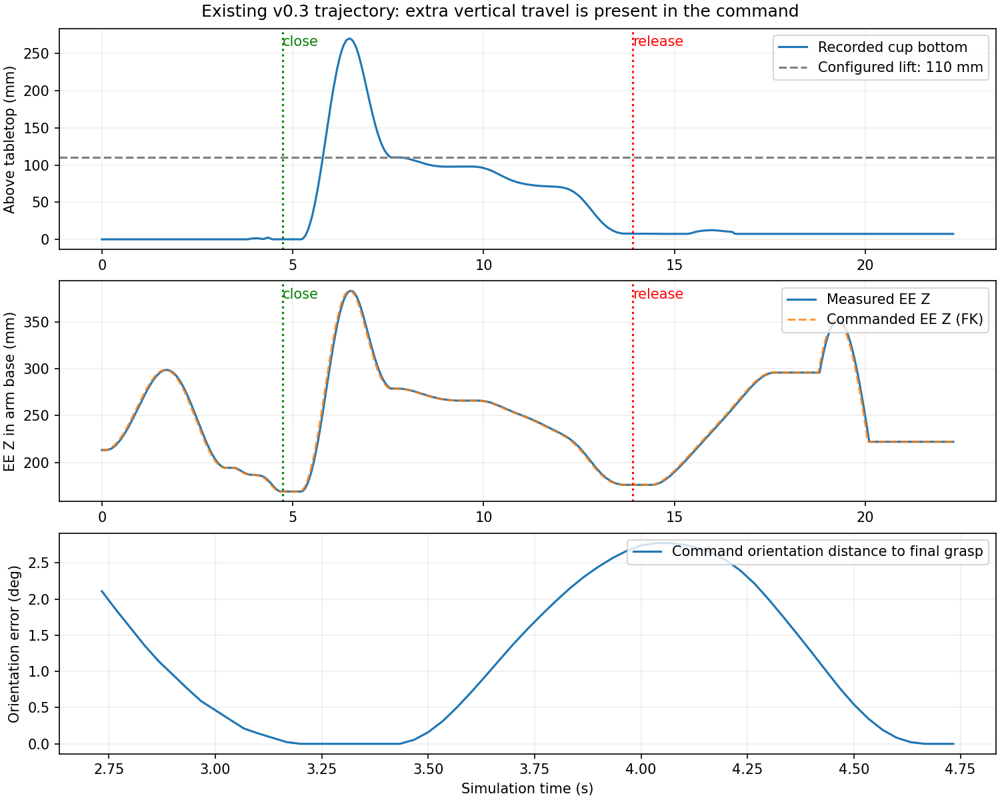

# D435i、冗余动作、推杯与背景设置排查

日期：2026-10-28。本文保留 v0.3 代码与轨迹的历史诊断。抓取深度、夹爪指令与轨迹优化已在 v0.4 实施，见 [v0.4 验证](cup_plate_motion_validation.zh-CN.md)。相机型号与地面纹理仍保持原设置。

## 外部相机 D435i

仓库已有 `workflows/simbox/core/configs/cameras/realsense_d435i.yaml`：640×480、30 Hz，预设 `[fx, fy, cx, cy] = [605.451, 605.137, 320.778, 255.816]`。修改 `task.yaml` 中 `split_aloha_external.camera_file` 即可使用，安装位姿可先保持不变。分辨率和视野会随内参变化，应重新检查构图。

当前相机由 `CustomCamera` 创建为虚拟针孔传感器。切换 YAML 不需要相机外壳 USD，也不会自动增加真实 D435i 的深度误差或 IMU 模拟。本地当前任务资产目录没有找到独立 D435i USD；官方 ROS 描述包含 D435i Xacro，引用 D435 外壳网格及 IMU 坐标描述，可在确有外观需求时导入。[官方 D435i 描述](https://github.com/realsenseai/realsense-ros/blob/ros2-master/realsense2_description/urdf/_d435i.urdf.xacro)

该参数文件是预设，不等于用户手中设备的实际标定；实机对齐优先使用相同分辨率下的 CameraInfo 内参。相机换型后原始输出宜另建版本目录，避免不同分辨率混入同一个后续导出批次。

## 已有轨迹中的冗余运动

读取包括用户新运行的 `2026-10-28_11_42_11_730256`、`11_43_03_992618`、`11_43_51_333121` 在内的轨迹：

- 夹爪闭合之前，杯子最大水平位移分别约 15.7、26.8、22.2 mm，表明推杯发生在闭爪之前。
- `11_43_03_992618` 中，杯底最高距桌面约 269.9 mm，尽管配置的抬升量是 110 mm。
- 同一条轨迹的指令 FK 和实测末端高度曲线基本重合，冗余抬升已存在于目标指令中，不能主要归因于伺服跟踪噪声或速度上限。
- 在最终接近过程中，指令姿态偏离终点姿态后又回到终点姿态，约有 2.8° 的中间偏转，符合用户观察到的先对准、再摇晃、最后闭爪。



原因在 `cup_plate_planning.py`：所有段使用 `plan_single_js`。它验证关节路径、碰撞和余量，没有要求末端沿笛卡尔直线运动，也没有固定接近过程的末端姿态或约束运输过程的高度。预抓与抓取 IK 的分支还分别相对同一起点评分，即使端点方向相同，中间关节路径也可能产生腕部摆动。

当前任务另显式包含 11 cm 抬升、盘上方 9 cm 预放置、放下后 12 cm 撤离，以及随后回零。末端的额外弧线叠加这些阶段，形成较明显的抬高、回落和放杯后点头。`heuristic_skill.py` 的回零也直接插值关节角，没有末端路径形状约束。其插值系数还带有 1.25 倍放大，但已有轨迹会提前结束，不能单凭该系数就断定实际发生了终点超调。

改法：接近/插入、抬升、落盘和撤离使用固定姿态的笛卡尔路径，并沿同一逆解分支连续跟踪；运输按杯底定义统一安全高度，增加路径长度、姿态变化和高度回折检查。回零可移到 episode 之间的重置流程；任务结束后在安全撤离位置验证杯子稳定即可。缩短高度参数时仍需用实际手指、杯子和盘沿几何验证间隙。

## 抓取伸入过多与推杯

### 抓取深度

标注生成器的 `row[3] = 0.025` 是 25 mm 抓取深度，不是无效占位值。机器人换算为：

```text
p_ee = p_grasp_center + approach * (depth - tcp_offset)
depth = 0.025 m
tcp_offset = 0.12 m
```

因此预定杯壁抓取中心位于 link6 前方约 95 mm。这个位置不等于声明的 120 mm TCP 平面。

直接读取 USD 碰撞几何并变换到 link6：掌部碰撞包围范围沿接近轴最远约 73.24 mm；两指碰撞几何沿轴约 58.5～135.0 mm。杯子直径 75 mm、高 80 mm，以 25°～30° 倾角接近时，其靠近掌部的一部分可能投影至 link6 前方约 45～50 mm，已与掌部包围范围重叠。

随后用一次独立 GPU 仿真增加杯子对 link6 掌部的接触视图确认：**闭爪前第 119～132 帧共 14 帧，掌部与杯子有接触，手指接触均为零；期间杯子水平移动约 14.8 mm**。因此掌部推杯已获实际接触证据，而不仅是包围盒推测。该运行仍完成任务，说明原成功标准没有排除闭爪前推杯。诊断不改变原动作，也没有把接触力添加到训练数据。

### 接近时整杯被排除

新规划器初始化时调用 `update_specific(ignore_substring + [paper_cup])`，在整个接近阶段排除了杯子，掌部碰杯也不会被规划碰撞检查发现。此前是为允许两指接触而这样处理，范围过宽。

应校核实际指腹参考点，减小或取消 25 mm 深度，再验证夹持覆盖量；保留杯子与掌部/腕部的碰撞验收，只允许两指在正确阶段接触杯壁。不能仅凭最终抓取成功接受闭爪前已推移的轨迹。

### 开爪目标超出单指范围

`SplitAlohaController.get_gripper_action()` 开爪返回 0.1 m，实际主动指关节上限为 0.05 m，总开度才是 0.1 m。当前依赖物理限位截断。该指令应改为单指实际范围，避免持续向关节限位外施加驱动目标；其对摇晃的具体贡献尚未单独量化。

接近完成判定还使用 5 mm、0.05 rad（约 2.86°）容差。建议用更精确的末段跟踪与短暂稳定性检查，然后保持同一末端目标闭爪，而不是在接近阶段继续调整腕部姿态。

## 更换背景

当前工厂画面来自 `workflows/simbox/assets/envmap_lib/abandoned_factory_canteen_01_1k.hdr`。`arena.yaml` 只有桌子和地面，没有那间工厂的三维房间资产。

目前代码扫描 `envmap_lib` 指定目录中的 `.hdr`，关闭随机化时取文件名排序后的第一张，强度固定 1000、旋转固定零。可把所需的一张 HDR 全景图放到仓库自己的目录，并改配置：

```yaml
env_map:
  envmap_lib: /home/agilex/qhx/InternDataEngine/local_configs/cup_plate_desk/backgrounds
  apply_randomization: false
```

此目录只放希望使用的那张 `.hdr`。当前入口不扫描 `.exr` 或普通 `.jpg`；单独写 `envmap_id` 不会生效，因为代码未读取该配置键。换 HDR 会同时改变远景和环境照明；需要真实墙体、地面和房间碰撞时，应另外在 arena 中加载场景 USD。

## 建议修改顺序

1. 修正抓取深度/指腹参考和单指开度指令，补上掌部与杯子的接触验收。
2. 对接近、抬升、落盘、撤离采用固定姿态与受控高度的笛卡尔路径，保证逆解分支连续。
3. 统一运输高度，压缩冗余阶段，把回零移出训练 episode。
4. 切换 D435i 参数并核对画面构图，再按上述背景入口替换 HDR。

保留用户要求的 J2/J3/J6 原限位、500 rad/s 运行时上限与质量参数。上一版完整链验证解决了可达性和最终成功判定，轨迹质量与接近碰撞的检查仍不足。

接触诊断记录及轨迹数值位于 `output/cup_plate_diagnostics/motion_camera_audit/`；运行日志 `/tmp/cup_palm_contact_probe2.log`。
