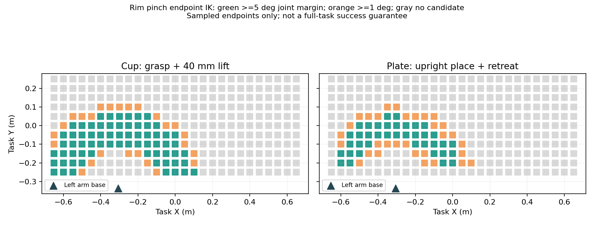

# 刚体纸杯内外壁顶抓：参考位置与可达区域

保持机器人安装位置、升降关节和原有关节限位。使用原刚体纸杯，一指进入杯内、一指在杯外，夹持同一侧杯壁。2026-10-30 更新后的标注使用距杯底 65、68、71、74 mm 的 TCP 高度，夹爪偏离竖直方向 0°、±2°、±5°、±10°，保留单向 +15°；上方允许调整姿态，最后 12 mm 稳定入杯段竖直下降。这些角度是候选，规划器筛选后选用一个，不保证等概率选取。

当前共有 768 个原始候选，已移除 77/80 mm、保留 +15°，并增加 10° 以内沿切线反方向的倾角。单元和几何检查不能替代 IK 或完整物理抓放验证。

之前加入过 77/80 mm 的近杯口候选；现已按用户要求移除，仅保留最高 74 mm。新组合的完整抓放成功率尚未验证。下文成功记录及可达性图使用此前的 65/68/71 mm、0°/10°/20° 候选，不代表新候选已验证。去掉 20° 同时缩小了姿态搜索范围，最终可达区域需要重新测试。

## 已完整跑通的一组位置

任务坐标系，单位米，桌面中心为 `(0, 0, 0.75)`。下表 XY 是物体中心，Z 是区域采样器相对桌面的偏移，运行时自动将物体放在桌面。

| 物体 | X | Y | 区域 Z 偏移 |
| --- | --- | --- | --- |
| 纸杯 | -0.306 | 0.020 | 0.0 |
| 盘子 | -0.100 | 0.000 | 0.0 |

2026-10-29 的两个固定布局实验各完成一次抓取、抬升、搬运、放置和稳定性检查，分别保存 294 帧和 293 帧。第二个实验使用当前空心杯碰撞代理。它们是单次成功证据，不代表重复成功率，也不能证明周围整片区域都成功。

证据保存在：

- `output/cup_plate_diagnostics/rim_pinch_tilted/engine/de_time_profile_20261029_163723.log`：成功 1/1，保存 294 帧。
- `output/cup_plate_diagnostics/rim_pinch_hollow/engine/de_time_profile_20261029_164944.log`：成功 1/1，保存 293 帧。
- 对应目录下的 `task.yaml`、`meta_info.pkl`、LMDB 和三路视频。

用已经保存的固定布局配置重跑一条：

```bash
SEED=42 OUT_DIR=output/cup_plate_diagnostics/rim_reference_replay/ \
bash scripts/run_cup_plate_desk.sh 1 \
  --name=output/cup_plate_diagnostics/rim_reference_replay/engine \
  --load_stage.scene_loader.args.cfg_path=output/cup_plate_diagnostics/rim_pinch_hollow/task.yaml
```

## 可供自行设置范围的候选区域

以下小矩形的 5 cm 网格点，均通过顶抓/抬升或放置/撤退的端点 IK 检查，且包含上述成功布局的 XY。它们是选择随机范围的参考，**尚未证明整个矩形或任意杯盘组合可以完整执行**。

| 物体 | X 参考范围（m） | Y 参考范围（m） |
| --- | --- | --- |
| 纸杯 | [-0.35, -0.30] | [0.00, 0.05] |
| 盘子 | [-0.15, -0.10] | [0.00, 0.05] |

较大的近端随机区域此前 3 次测试均完成夹持和抬升，但未完成放置；另一个靠近机器人方向的区域 3 次未形成完整任务。因此不能把端点 IK 通过率当成抓放成功率。尤其抓取后杯子相对夹爪发生转动时，实际放置姿态需要重新求解。

本次不覆盖用户的随机范围。在 `local_configs/cup_plate_desk/task.yaml` 的 `regions` 下分别编辑 `paper_cup` 与 `ceramic_plate` 的 `random_config.pos_range`，第一行是 XYZ 下界，第二行是上界。只测试上述固定位置时，将对应两行写成相同值即可。`yaw_rotation` 可继续保留。

## 可达性图及限制



以 5 cm 间距采样桌面附近 297 个位置：抓取与抬升端点同时可解的点有 92 个，放置与撤退端点同时可解的点有 69 个。绿点最小关节余量至少 5°，橙点至少 1°，灰点无通过候选。可达区域不规则，不能把所有成功点的外接矩形当成安全随机范围。

检查使用运行记录重建的左臂基座、相同夹爪预开度、原有关节限位、桌面碰撞与自身碰撞，并要求同一候选姿态在上下两个端点均可解。尚未检查端点间连续路径、抓取后的接触稳定性、实际杯姿漂移及携杯碰撞。图中的盘子结果按候选抓持变换计算，不能替代执行后的放置重规划。

完整 CSV/JSON 在 `output/cup_plate_diagnostics/rim_pinch_workspace_full/`，生成脚本是 `scripts/diagnostics/map_cup_rim_workspace.py`。例如：

```bash
bash scripts/isaac_python.sh scripts/diagnostics/map_cup_rim_workspace.py \
  --episode output/cup_plate_diagnostics/rim_pinch_hollow/BananaBaseTask/split_aloha/custom/pick_cup_to_plate_desk/desk_edge/2026-10-29_16_50_27_031030 \
  --output output/cup_plate_diagnostics/rim_workspace_recheck
```

2026-10-30 补充检查：93 项单元测试通过，两个采集入口脚本通过 Bash 语法检查。GPU 的 NVML 报 `Driver/library version mismatch`，库版本为 580.178，因而未补跑新的物理随机布局。本文区分此前完整任务成功证据与端点 IK 结果。
